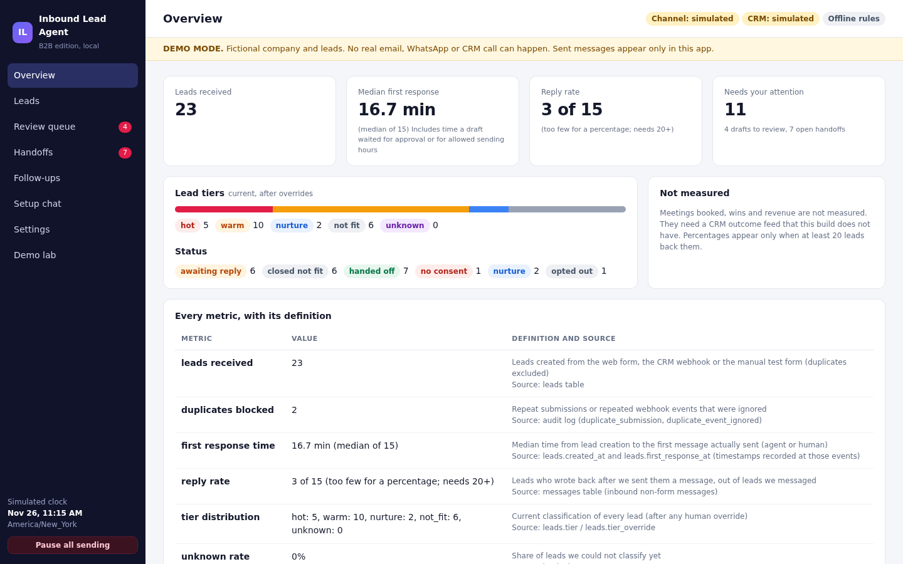
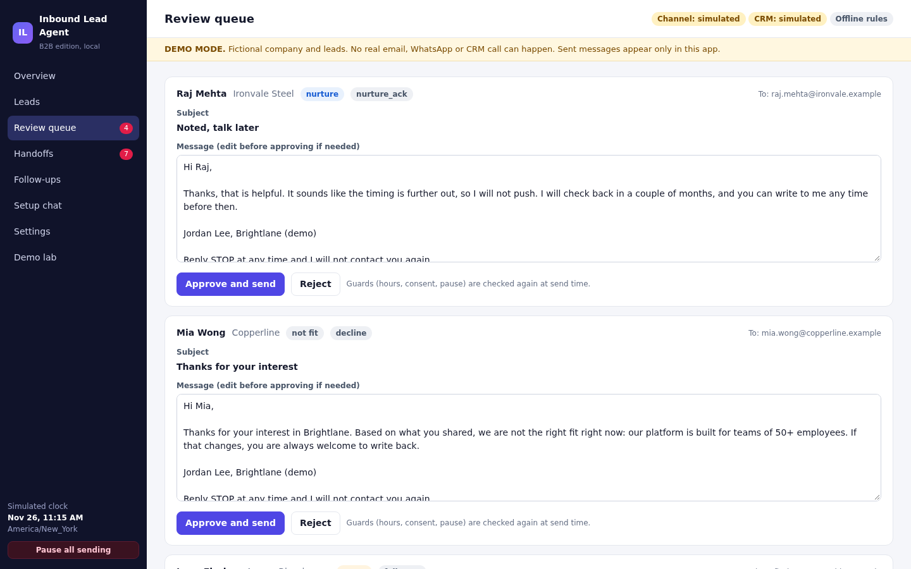
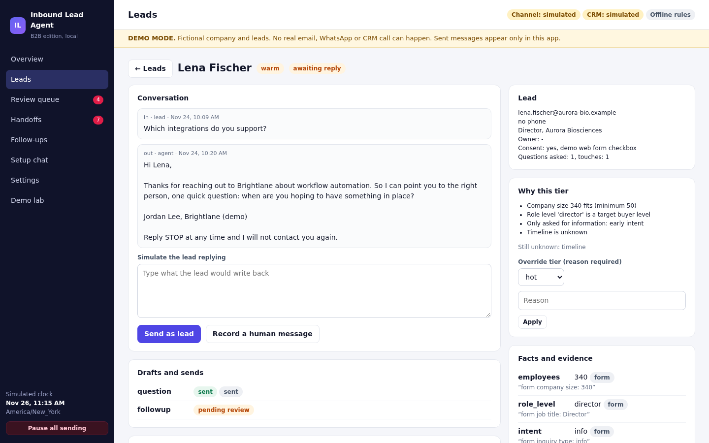
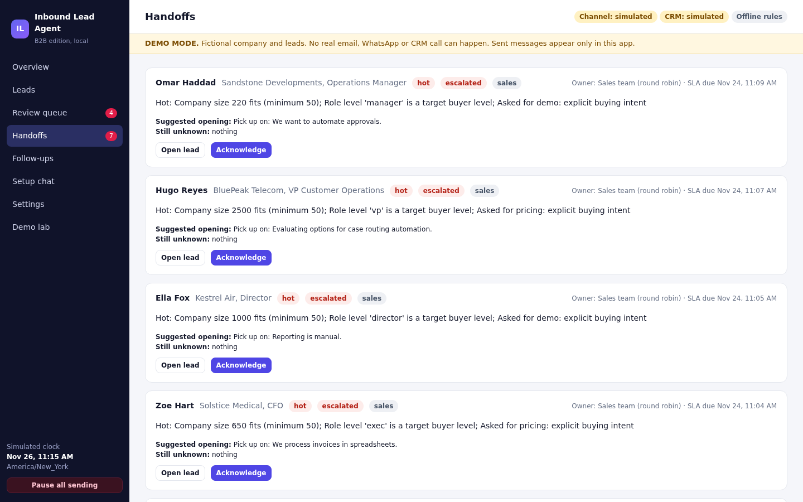
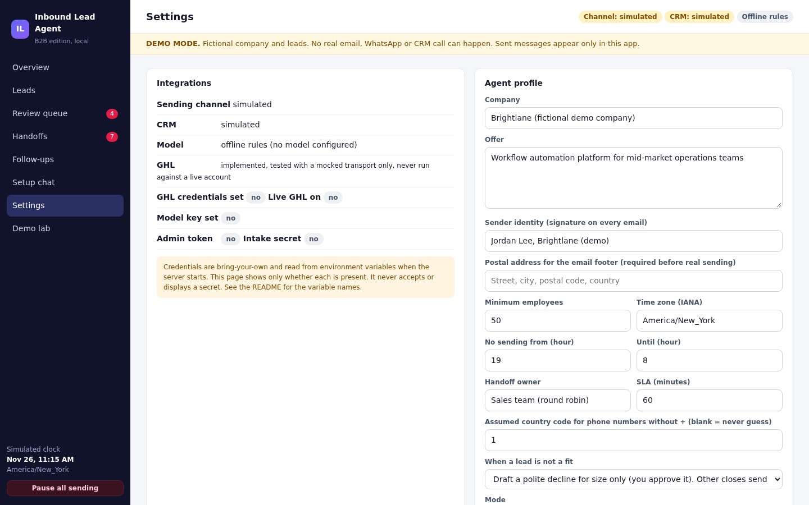
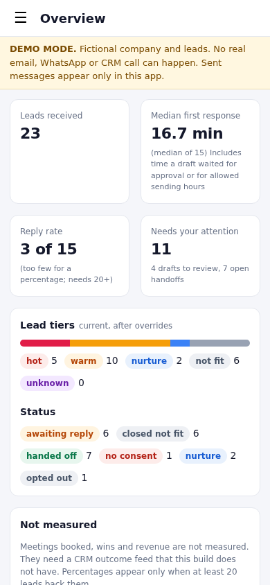

# Inbound Lead Agent (B2B edition)

A local web app that handles inbound B2B leads from first form submission to a human handoff. It checks consent, qualifies each lead from quoted evidence, drafts a short reply for a person to approve, schedules follow-ups, and hands hot leads to a salesperson with a summary card.

**Status: local prototype. Runs offline in simulation mode.** Nothing is sent to anyone, and nothing has been tested against live Gmail, GoHighLevel or an AI model. The demo company "Brightlane" and every lead in it are invented.



## Demo video

[docs/demo/inbound-lead-agent-demo.mp4](docs/demo/inbound-lead-agent-demo.mp4) (about 5.5 minutes, English narration, narrated walkthrough of the running app). It marks clearly what runs now (offline simulation) and what is only a plan for your own setup. The Facts and Handoff close-up near 1:53 uses a simplified single-column layout (captioned in the video); the real app shows it in two columns, as in the screenshots.

## The problem

Inbound leads arrive from forms and CRM contacts, and the first reply decides a lot. Small teams answer late, answer everyone the same way, forget follow-ups, or message people who never agreed to be contacted. Reps also open a lead with no idea why it was marked "hot".

## How it helps

- **Consent first.** No recorded consent, no draft.
- **Evidence, not guesses.** Each fact (company size, role, intent, timeline, budget) keeps the exact quote it came from. Tiers: hot, warm, nurture, not fit, unknown, each with reasons and what is missing.
- **You approve.** Drafts wait in a Review queue. Safety checks run again at send time.
- **Careful with replies.** Opt-outs, refusals, ambiguous wording and suspicious text stop automation and go to a person.
- **Clean handoff.** Hot leads become a card with an owner, a suggested opening and an SLA. After handoff the agent stays quiet.

| Review queue | Lead evidence |
| --- | --- |
|  |  |
| **Handoffs** | **Settings** |
|  |  |

## Quick start

Requires Python 3.10 or newer (developed and tested on 3.10.12, Linux).

```bash
git clone <your-repo-url> inbound-lead-agent   # replace with the URL of your own copy
cd inbound-lead-agent
./run.sh
```

`run.sh` creates a `.venv`, installs 3 packages and serves http://127.0.0.1:8765. Open it, go to **Demo lab**, click **Load demo scenario**. You get about 23 invented leads played through the real pipeline on a simulated clock.

On Windows, `run.sh` is untested. Manual steps (also untested): create a virtualenv, `pip install -r requirements.txt`, then `python -m ila.api`. The `Dockerfile` is also untested.

The database is SQLite at `data/ila.db` (override with `ILA_DB`; it is git-ignored). The server listens on 127.0.0.1 port 8765. Change the port with `ILA_PORT` (for example `ILA_PORT=9000 ./run.sh`) and the address with `ILA_HOST`.

Tests: `pip install -r requirements-dev.txt && python -m pytest -q`.

On a phone-sized screen the layout adapts:



## Walkthrough

1. **Overview**: lead tiers, status counts, and metrics, with a "not measured" box for things the app cannot know (meetings, wins, revenue).
2. **Leads**: open a lead to see facts with quotes, the conversation, the draft, and the audit trail. A "provisional" badge means the data conflicts and a human decides.
3. **Review queue**: edit, approve or reject drafts. Approved drafts go to the simulator.
4. **Handoffs**: acknowledge hot leads. Unacknowledged ones escalate after the SLA. Demo lab can advance the simulated clock.
5. **Settings**: sending hours, minimum company size, policy for not-fit leads, sender identity and postal address. A "Pause all sending" kill switch sits in the sidebar.
6. **Setup chat**: a short guided chat that fills in the profile. It refuses credentials.

## Features

- Form intake and GHL webhook intake (signature checked), duplicate detection
- Consent tracking and suppression list
- Rule-based qualification with evidence quotes; optional model extractor (see limits)
- Review queue with edit, approve, reject, and an audited "uncertain send" flow
- Follow-up scheduler with touch limit and stop rules
- Handoff cards with SLA and escalation
- Kill switch, daily cap, quiet hours per operator time zone
- Prompt-injection flagging for lead text
- 210 automated tests

Full decision rules: [docs/BEHAVIOR.md](docs/BEHAVIOR.md).

## Status, stated plainly

| Area | Status |
| --- | --- |
| Pipeline (intake, consent, dedupe, qualification, review queue, follow-ups, handoff, SLA, kill switch) | Built and covered by automated tests, running offline |
| Sending channel | **Simulator only.** No email, SMS or WhatsApp is sent by this build |
| Qualification | Rule-based and offline. An optional model extractor exists, tested only with a fake transport. **Never run against a live model API** |
| GoHighLevel (GHL) adapter | Written against the official HighLevel API docs and tested on a mocked transport. **Never run against a live GHL account** |
| Webhook signature check | Ed25519 `X-GHL-Signature`, tested with a generated key pair |
| Outcomes (meetings, wins, revenue) | Not measured. The app says so |
| Production readiness | **Not claimed.** It is a reviewed local prototype |

## Connecting your own accounts (planned, never run live)

Credentials are read from environment variables at startup. The UI and the setup chat refuse to accept them and only show whether each one is present.

| Variable | Purpose |
| --- | --- |
| `ANTHROPIC_API_KEY`, `ILA_ANTHROPIC_MODEL` | Turn on the optional model extractor. You choose the model name |
| `GHL_PRIVATE_INTEGRATION_TOKEN`, `GHL_LOCATION_ID` | GHL Private Integration token (scopes: `contacts.write`, `conversations/message.write`) |
| `ILA_USE_GHL=1` | Use GHL for contacts, email and tasks instead of the simulators |
| `ILA_ADMIN_TOKEN` | Require `X-Admin-Token` on the admin API. **Set this before binding to anything but localhost** |
| `ILA_INTAKE_SECRET` | Require `X-Intake-Secret` on `POST /api/intake/form` (needed for non-local callers) |
| `ILA_ALLOWED_HOSTS` | Comma-separated host names the app answers to besides localhost (a foreign `Host` header gets 400, which blocks DNS rebinding) |

Before enabling `ILA_USE_GHL=1`, test with a sandbox sub-account and a contact you own. Nothing in this repository has done that yet.

There is no `.env.example` file. Set variables in your shell before `./run.sh`. This repository does not include or claim MCP support.

## API

OpenAPI docs at `/api/docs`. Main endpoints: `POST /api/intake/form`, `POST /api/webhooks/ghl` (signature required), `GET /api/leads`, `GET /api/actions`, `POST /api/actions/{id}/approve`, `GET /api/handoffs`, `POST /api/kill-switch`, `GET /api/metrics`.

## Limits and legal note

- Phone-only leads are not messaged (email only); they go to a human. A 10-digit phone number without `+` uses the profile's assumed country code (default 1, blank means never guess).
- Email duplicates ignore `+tags` (`ann+demo@x.com` is `ann@x.com`).
- Cross-origin POSTs (an `Origin` header that is not an allowed host) are refused.
- The GHL webhook is signature-verified and deduplicated by event id, but has no timestamp replay window.
- Mutating API calls need the `X-ILA-Client` header (the UI sends it), so a web page on another site cannot trigger them. Demo routes are disabled when a live channel or CRM is configured.
- Single-process, single-operator. No users or roles beyond the optional admin token.
- No HTTPS. Put it behind a TLS proxy if you ever expose it.
- Only email is modelled. WhatsApp and SMS need their own consent and template rules, which are not implemented.
- **This software is not legal advice.** Rules on consent, unsolicited commercial messages and data protection differ by country and state. Each operator must have their own use reviewed by qualified local counsel before contacting real people. The default templates include an unsubscribe line, which does not by itself make a message compliant.
- The demo company "Brightlane" and every lead are invented. Any resemblance to real people or companies is accidental.

## Layout

`ila/` engine, qualification, adapters, API, `static/` UI. `tests/` pytest suite. `docs/` behavior notes, screenshots, demo video. `Dockerfile`, `run.sh`, `requirements*.txt`.

## License

No open-source license has been selected yet. Until the owner chooses one, no redistribution license is granted. Dependency licenses remain their own.
